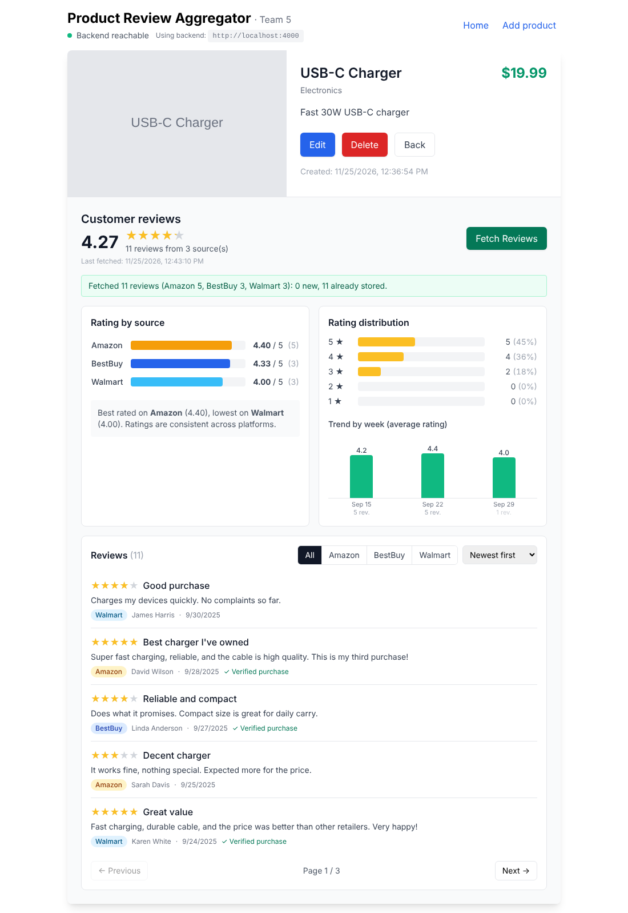

# Multi-Source Product Review Aggregator — Team 5

**ECMN2026 · Full-stack JavaScript Web Development (Emmanuel Bruno, Université de Toulon)**

| TMU ID | Name |
|---|---|
| 24K610014 | Doan Ngoc Anh |
| 24K610109 | Lai Khanh Phuong |
| 24K610095 | Nguyen Bao Ngoc |
| 24K610127 | Nguyen Mai Trang |
| 24K610126 | Bui Mai Trang |

Built on top of the course starter [`ebpro/fullstack-minimal-app`](https://github.com/ebpro/fullstack-minimal-app) (product catalog + mock scraper). The original starter README is kept in [`docs/STARTER_README.md`](docs/STARTER_README.md).



---

## 1. What the application does

A product sold on several platforms gets reviews in several places. This app **collects reviews from Amazon, BestBuy and Walmart** (simulated by the course scraper service), **stores them in MySQL**, and shows **one consolidated view** with statistics for managers, marketers and customers.

### Features

| Feature | Where |
|---|---|
| **On-demand fetching**: reviews are retrieved only when the user clicks **Fetch Reviews** (no background polling) | `ReviewSummary.jsx` → `POST /api/products/:id/fetch` |
| **Persistence in MySQL**: stats and lists load from the database instantly, without calling the scraper again | `reviews` table, `reviewService.js` |
| **No duplicates**: re-fetching the same product updates existing reviews instead of inserting them again (`UNIQUE (product_id, source, review_id)` + upsert) | `db/init.sql`, `fetchAndStoreReviews()` |
| **Rate-limit protection**: the same product cannot be fetched again within 5 s (HTTP 429 with a "please wait" message) | `FETCH_COOLDOWN_MS` |
| **Overall rating**: average (2 decimals), stars and total number of reviews | `ReviewSummary.jsx` |
| **Rating by source**: average and count per platform as a bar chart, plus an automatic insight ("best rated on X, lowest on Y") | `SourceBreakdown.jsx` |
| **Rating distribution**: 1–5 star histogram with counts and percentages | `ReviewStats.jsx` |
| **Trend timeline** (optional feature): average rating per week | `ReviewStats.jsx`, `timeline` in `/aggregate` |
| **Review list**: author, stars, title, comment, date, source badge, verified-purchase flag | `ReviewList.jsx` |
| **Filter by source** (All / Amazon / BestBuy / Walmart), **sort** (newest, oldest, highest, lowest rating) and **pagination** (5 per page) | `ReviewList.jsx`, `GET /reviews?source&sort&page` |
| **Custom hook** `useProductReviews()` that loads stats + list in parallel, cancels outdated requests and reloads after a fetch | `frontend/src/hooks/useProductReviews.js` |
| **Clear error messages**: scraper down (503), scraper too slow (504), no reviews for this product (404), invalid query (400) | `scraperClient.js`, `validators.js` |
| Product catalog CRUD (from the starter): list, filter by category, add, edit, delete | starter code |

---

## 2. Architecture

```text
 React + Vite (5173)                 Express API (4000) — "the hub"            Scraper service (5000)
 ┌─────────────────────┐  HTTP/JSON  ┌──────────────────────────────┐  HTTP   ┌──────────────────────┐
 │ ProductDetail        │ ──────────► │ routes/products.js           │ ──────► │ GET /api/scrape/     │
 │  └ ReviewSection     │             │  └ services/reviewService.js │         │   reviews/:productId │
 │     ├ ReviewSummary  │ ◄────────── │     └ services/scraperClient │ ◄────── │ (Amazon, BestBuy,    │
 │     ├ SourceBreakdown│             └──────────────┬───────────────┘         │  Walmart mock data)  │
 │     ├ ReviewStats    │                            │ SQL (mysql2 pool)       └──────────────────────┘
 │     └ ReviewList     │                            ▼
 │ hooks/useProductReviews                    MySQL / MariaDB (3306)
 └─────────────────────┘                    products, categories, reviews
```

- The **frontend never calls the scraper directly**: only the backend does, so URLs and rate limits stay server-side.
- Statistics are computed **in SQL** (`AVG`, `COUNT`, `GROUP BY`), not in JavaScript.

### Files added or changed by Team 5

```text
db/init.sql                              + reviews table (appended after the starter schema)
db/reviews.sql                           same table, standalone script for an existing database
backend/src/services/scraperClient.js    calls the scraper (timeout + error mapping)
backend/src/services/reviewService.js    SQL for list / aggregate / fetch-and-store
backend/src/routes/products.js           + 3 review routes
backend/src/middleware/validators.js     + validateReviewQuery
backend/src/db.js                        UTC time zone for dates
backend/test/smoke.js                    + tests for the review endpoints
frontend/src/hooks/useProductReviews.js  custom data hook
frontend/src/components/reviews/*        ReviewSection, ReviewSummary, SourceBreakdown, ReviewStats, ReviewList, StarRating
frontend/src/components/ProductDetail.jsx  renders <ReviewSection> under the product info
frontend/src/components/ProductList.jsx    fix: "Next" page button was reset to page 1 (starter bug)
api-tests.http                           + review requests (VS Code REST Client)
```

The **ProductPage** of the brief is `ProductDetail.jsx` (product info) + `ReviewSummary.jsx` (Fetch button, overall average, total count).

---

## 3. REST API

| Method | Endpoint | Description |
|---|---|---|
| `POST` | `/api/products/:id/fetch` | Calls the scraper, validates each review, upserts it in MySQL (one transaction) |
| `GET` | `/api/products/:id/reviews` | Stored reviews. Query: `source=amazon\|bestbuy\|walmart\|all`, `sort=newest\|oldest\|rating_desc\|rating_asc`, `page`, `per_page` (≤ 50) |
| `GET` | `/api/products/:id/aggregate` | Overall average, per-source averages, 1–5 histogram, weekly timeline |

**`POST /api/products/1/fetch`**
```json
{ "data": { "product_id": 1, "fetched": 11, "inserted": 11, "updated": 0, "skipped": 0,
            "per_source": { "Amazon": 5, "BestBuy": 3, "Walmart": 3 },
            "fetched_at": "2026-11-25T05:38:22.400Z" } }
```
Fetching again → `"inserted": 0, "updated": 11` (no duplicate rows).

**`GET /api/products/1/aggregate`**
```json
{ "data": { "overall_avg": 4.27, "count": 11,
            "per_source": { "Amazon": { "avg": 4.4, "count": 5 }, "BestBuy": { "avg": 4.33, "count": 3 }, "Walmart": { "avg": 4, "count": 3 } },
            "histogram": { "1": 0, "2": 0, "3": 2, "4": 4, "5": 5 },
            "timeline": [ { "week": "2025-09-15", "avg": 4.2, "count": 5 }, { "week": "2025-09-22", "avg": 4.4, "count": 5 }, { "week": "2025-09-29", "avg": 4, "count": 1 } ],
            "last_fetched_at": "2026-11-25T05:38:28.000Z" } }
```
A product with no reviews returns `overall_avg: null`, `count: 0`, empty `per_source` and all histogram buckets at 0.

**`GET /api/products/1/reviews?source=amazon&per_page=2`**
```json
{ "data": [ { "review_id": "AMZ_0005", "source": "Amazon", "author": "David Wilson", "rating": 5,
              "title": "Best charger I've owned", "body": "Super fast charging, …",
              "created_at": "2025-09-28T11:30:00.000Z", "verified_purchase": true }, … ],
  "meta": { "count": 2, "total": 5, "page": 1, "per_page": 2, "total_pages": 3, "source": "Amazon", "sort": "newest" } }
```

| Error | Status | Example message |
|---|---|---|
| Unknown product | 404 | `Product not found` |
| Scraper has no data for this product | 404 | `No reviews available from the sources for this product` |
| Fetch clicked again within 5 s | 429 | `Reviews were just fetched. Please wait 4s before fetching again.` |
| Scraper not running | 503 | `Scraper service unavailable. Is it running on http://localhost:5000?` |
| Scraper too slow (> 8 s) | 504 | `Scraper did not answer within 8000 ms` |
| Invalid query (`source=ebay`, `per_page=500`) | 400 | `Validation failed` + details |

---

## 4. Database

```sql
CREATE TABLE reviews (
  id INT AUTO_INCREMENT PRIMARY KEY,
  product_id INT NOT NULL,                 -- FK products(id) ON DELETE CASCADE
  source VARCHAR(32) NOT NULL,             -- Amazon | BestBuy | Walmart
  review_id VARCHAR(64) NOT NULL,          -- id from the source, e.g. AMZ_0001
  author VARCHAR(100) NOT NULL,
  rating INT NOT NULL CHECK (rating BETWEEN 1 AND 5),
  title VARCHAR(255), body TEXT,
  created_at TIMESTAMP NOT NULL,           -- when the customer wrote the review
  verified_purchase BOOLEAN NOT NULL DEFAULT FALSE,
  fetched_at TIMESTAMP NOT NULL,           -- last time we retrieved it
  UNIQUE KEY uq_review (product_id, source, review_id)
);
```

- `UNIQUE (product_id, source, review_id)` + `INSERT … ON DUPLICATE KEY UPDATE` = no duplicates, and `fetched_at` keeps the history of the last retrieval.
- All queries use `?` placeholders (no SQL injection). The `ORDER BY` column comes from a whitelist because it cannot be parameterized.
- Each scraped review is validated before insert (known source, integer rating 1–5, non-empty id); invalid ones are counted in `skipped`.

---

## 5. Installation and running

Requirements: **Node.js 22+**, and either **Docker Desktop** (option A) or **MySQL/MariaDB** e.g. XAMPP (option B).

### Option A — Docker (everything in one command)

```bash
docker compose up --build
```
Opens MySQL (3306), backend (4000), scraper (5000) and frontend (5173). Go to <http://localhost:5173>.

> Already ran the starter before? Its database volume has no `reviews` table. Either reset it
> (`docker compose down -v && docker compose up --build`, this wipes the data) or add the table only:
> `docker compose exec -T mysql mysql -uappuser -papppassword minimal_app_db < db/reviews.sql`

### Option B — Local (XAMPP / MySQL)

1. Start **MySQL** in XAMPP. In phpMyAdmin create the database `minimal_app_db`, then **Import** `db/init.sql`.
2. Configure the backend:
   ```bash
   cp backend/.env.example backend/.env
   ```
   With XAMPP's default account, set `DB_USER=root` and `DB_PASSWORD=` (empty) in `backend/.env`.
3. Install and start everything (backend + frontend + scraper):
   ```bash
   npm run setup     # npm install + scraper-service dependencies
   npm run dev
   ```
4. Open <http://localhost:5173>.

### Using the app

1. On the home page, open **USB-C Charger** (product 1).
2. Click **Fetch Reviews** → 11 reviews are collected (Amazon 5, BestBuy 3, Walmart 3).
3. Explore the rating by source, the histogram, the weekly trend, and the review list (filter / sort / pages).
4. Click **Fetch Reviews** again after 5 s → "0 new, 11 already stored": no duplicates.

> The mock scraper only has reviews for **product IDs 1, 2 and 3**. Other products show "No reviews available from the sources for this product".

### Tests

```bash
npm --workspace=backend test   # smoke tests: health, catalog, aggregate shape, fetch twice → no duplicates, source filter, 400/404
npm run lint                   # ESLint backend + frontend
```
Manual requests are in `api-tests.http` (VS Code REST Client extension).

---

## 6. Known limitations and future work

- The mock scraper matches reviews **by product ID**, so product 2 of the catalog ("Wireless Mouse") receives the scraper's "Wireless Bluetooth Headphones" reviews. A real version would map catalog products to each platform's product ID.
- The 5 s cooldown is kept in memory: it resets when the backend restarts and is per server instance.
- No authentication: anyone using the app can trigger a fetch.
- Ideas: automatic scheduled refresh, sentiment analysis of comments, CSV export, comparison between products.

## 7. LLM usage

See [`LLM_Usage.md`](LLM_Usage.md).
